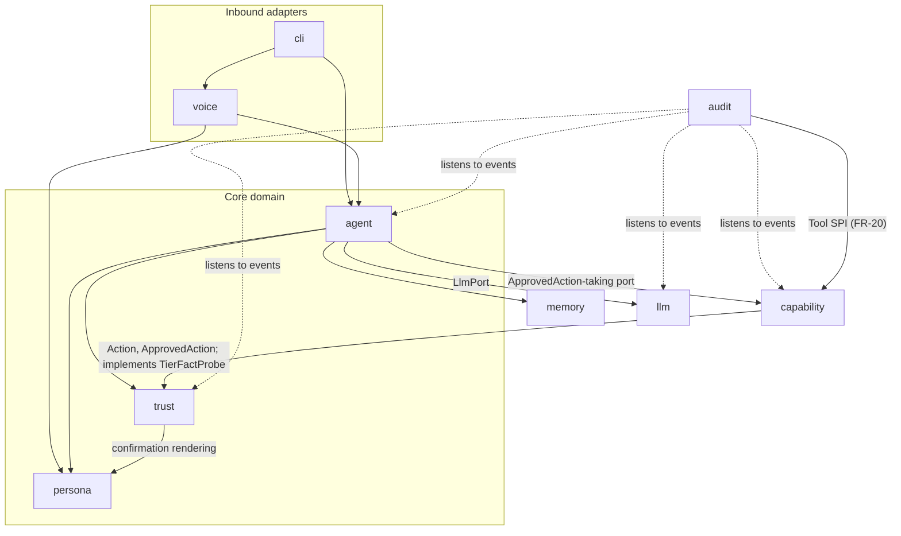
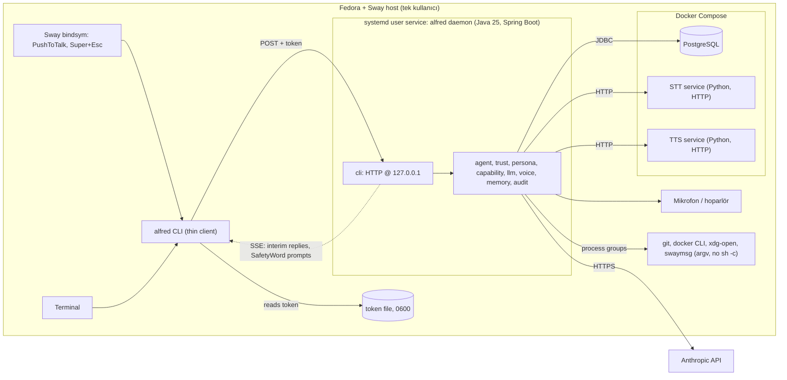

# Architecture Spine — alfred.ai

## Design Paradigm

**Hexagonal (ports & adapters), modüler monolit.** Her bounded context bir Spring Modulith application module'üdür (`ai.alfred`'in doğrudan alt paketi). Domain; Claude, ses motorları, Docker ve HTTP'den portlarla yalıtılır. Tek Java süreci host'ta çalışır; bağımlılıklar (Postgres, STT, TTS) Docker Compose'tadır.

| Modül (paket) | Sorumluluk | Alt alan |
| --- | --- | --- |
| `agent` | Karar döngüsü; Task yaşam döngüsü, doğrulama (FR-8), iptal, FR-14 uyarı durumu, girdi yönlendirme | core |
| `trust` | `Action` modeli, komut ayrıştırma, Tier sınıflandırma, korunan kaynaklar, SafetyWord, `ApprovedAction` üretimi ve tüketimi; `TierFactProbe` portu | core |
| `persona` | Alfred system prompt'u, stil kuralları, kullanıcıya dönük metinlerin render'ı | core |
| `capability` | First-party Tool'lar (shell, file, git, docker, browser/YouTube); yalnızca `ApprovedAction` yürütür; `TierFactProbe` adapter'ı | supporting |
| `llm` | `LlmPort` + Claude adapter; maliyet defteri, bütçe ve Tur sınırı uygulaması | generic + politika |
| `voice` | `SpeechToText` / `TextToSpeech` portları, Compose adapter'ları, PushToTalk | generic |
| `memory` | Geçici, tek paylaşılan Conversation (yalnızca bellek) | supporting |
| `audit` | Yalnızca eklenebilen AuditLog; olay dinleyicisi; FR-20 gün özeti Tool'u | supporting |
| `cli` | Inbound adapter: localhost HTTP API (POST + SSE, daemon tarafı) | adapter |

Bağımlılık yönü (ok = "derleme zamanında bağımlı olabilir"; listede olmayan kenar yasaktır):



## Invariants & Rules

### AD-1 — Modül sınırları Spring Modulith ile doğrulanır [ADOPTED]

- **Binds:** all (Design Paradigm'deki dokuz modül)
- **Prevents:** Sınırların zamanla sızması; güven kapısının bir katman atlanarak by-pass edilmesi.
- **Rule:** Modüller yalnızca birbirinin public API paketine (modül kök paketi veya `@NamedInterface`) erişir; `internal` alt paketlere erişim yasak. `ApplicationModules.of(AlfredApplication.class).verify()` her build'de koşan bir testtir; ihlal build'i kırar. Döngüsel modül bağımlılığı yasak. Postgres'e dokunan testler Testcontainers ile gerçek Postgres'e karşı koşar (mock DB yok).

### AD-2 — Bağımlılık yönü ve portlar [ADOPTED]

- **Binds:** all
- **Prevents:** Core'un altyapıya bağlanması; `agent`'ın Tool'ları güven kapısı dışından çağırması; audit'e bağımlılık döngüsü.
- **Rule:** Yalnızca Design Paradigm diyagramındaki kenarlara izin verilir. `agent` orkestre eder; `capability`'ye yalnızca `ApprovedAction` alan portu üzerinden erişir. `trust`'ın ihtiyaç duyduğu sistem bilgisi ters çevrilmiş port ile gelir (AD-19); kenar yönü `capability → trust` kalır. Core modüller (`agent`, `trust`, `persona`) Spring AI, Anthropic SDK, HTTP istemcisi veya ses motoru tipi import etmez. Hiçbir modül `audit`'e derleme bağımlılığı kurmaz; `audit` yalnızca olay dinler. FR-20 gün özeti, `audit`'in `capability`'nin Tool SPI'ına kaydettiği Tier 0 okuma Tool'udur (döngüsüz yol).

### AD-3 — `ApprovedAction` (OnaylıEylem) tek yürütme yetkisidir [ADOPTED]

- **Binds:** FR-10, FR-11, FR-12, FR-13, FR-14, FR-15, SM-5; `trust`, `capability`, `agent`
- **Prevents:** Onaysız Eylem; onaydan sonra parametre veya bağlam değiştirme; onayın tekrar kullanılması; iki ayrı `Action` modeli; Tool'un kendi Tier'ini beyan etmesi; yedeği başarısız olmuş üzerine yazma.
- **Rule:**
  - `Action` modeli `trust`'ın public API'sindedir; `capability` Tool'ları bu modele eşlenir. Tool SPI'ında Tier alanı yoktur; Tier'i yalnızca `trust` atar (AD-4). Bilinmeyen Tool = Tier 2.
  - `ApprovedAction` yalnızca `trust` içinde oluşturulabilir (package-private constructor, public factory yok), `actionId` (UUID) taşır ve seri hâle getirilmez (HTTP/JSON'a çıkmaz).
  - İçeriği: ayrıştırılmış argv aşamaları, mutlak `cwd` ve açık env allowlist'i. `capability` yalnızca bunu yürütür; her Eylem bu bağlamla yeni bir süreçte koşar, kalıcı shell oturumu yoktur.
  - Tek kullanımlıktır: tüketim `trust`'ta `actionId` ile kaydedilir; ikinci tüketim hata fırlatır.
  - Kademe 0 Eylem'ler için de `trust` otomatik `ApprovedAction` üretir; `capability`'de `ApprovedAction` almayan yürütme yolu yoktur. Yürütme yolu senkron çağrıdır (olay değil).
  - FR-13: yedek + üzerine yazma tek bir `ApprovedAction` içinde sıralı adımlardır; yedek adımı başarısızsa yazma adımı koşmaz ve Eylem iptal edilir.

### AD-4 — Kademe deterministik ve fail-closed belirlenir; ayrıştırılan yürütülür [ADOPTED]

- **Binds:** FR-12, FR-13, FR-14; `trust`, `capability`
- **Prevents:** Modelin Kademe düşürmesi; sınıflandırılan ile yürütülen arasındaki fark (`sh -c`); birleşik veya sarmalayıcı komutla kuralın atlanması.
- **Rule:**
  - Tier'i yalnızca `trust`'taki deterministik kod atar; LLM çıktısı Tier'i düşüremez. Tier'i etkileyen sistem bilgisi yalnızca `TierFactProbe`'dan gelir (AD-19), asla `agent`'tan veya LLM çıktısından gelmez.
  - `trust` komutu gerçek shell grammar ile argv aşamalarına (pipeline, yönlendirmeler) ayrıştırır. Kurallar argv üzerinde eşleşir, string önekinde değil. Birleşik komutta en yüksek parça Tier'i geçerlidir. `>`/`>>` dosya yazma sayılır.
  - `capability` ayrıştırılmış argv'yi doğrudan yürütür (`ProcessBuilder` pipeline). `sh -c` / `bash -c` ile yürütme yoktur.
  - Ayrıştırıcının tam modellemediği her yapı (backtick, `$(...)`, `||`, `&`, newline, process substitution, heredoc, değişken genişletme, `eval`/`source`) = Tier 2.
  - Sarmalayıcı / iç içe komut çalıştıran komutlar (`sudo`, `env`, `xargs`, `sh -c`, `docker exec`, `find -exec` / `-delete`) argv'nin herhangi bir yerinde = Tier 2.
  - Tanınmayan / sınıflandırılamayan / ayrıştırılamayan Eylem = Tier 2.
  - FR-13 yedeği alınan üzerine yazma Tier 1'e iner (AD-3 sıralı adımlarıyla).

### AD-5 — SafetyWord `trust`'ta üretilir, doğrulanır ve tüketilir [ADOPTED]

- **Binds:** FR-15, UJ-1 kenar durumu; `trust`, `agent`, `persona`, `voice`, `cli`
- **Prevents:** "Evet"/niyet beyanının onay sayılması; modelin onay vermesi veya kelimeyi görmesi; kullanıcının LLM açıklamasını onaylayıp başka komutun koşması; kelimenin tekrar veya durdurmadan sonra kullanılması.
- **Rule:**
  - Her Tier 2 Eylem için `trust` rastgele, tek kullanımlık bir kelime üretir. Kelime yalnızca ilgili bekleyen Eylem'e bağlıdır.
  - Onay metni `trust` tarafından ayrıştırılmış `Action`'dan (birebir komut, hedef) kurulur ve `persona` tarafından render edilir. LLM açıklaması eşlik edebilir ama komutun yerine geçmez.
  - Kelime beklenirken `agent` bir sonraki kullanıcı girdisini yalnızca `trust`'a yönlendirir. Girdi hangi kanaldan gelirse gelsin (ses veya CLI) kabul edilir. Karşılaştırma LLM'den geçmez; kelime ve girdi `LlmPort`'a, `memory`'ye ve log'a gitmez; AuditLog yalnızca onay durumunu tutar.
  - Yanlış kelime → yeni kelime üretilir ve tekrar sorulur; 3 başarısız denemeden sonra Eylem iptal edilir.
  - EmergencyStop bekleyen tüm SafetyWord'leri geçersiz kılar (AD-14).

### AD-6 — Kontrol yolu senkron, audit yolu olay tabanlı ve transaction içinde [ADOPTED]

- **Binds:** all; özellikle `agent`, `trust`, `capability`, `llm`, `audit`
- **Prevents:** Senkron döngüye olay karmaşası (iptal, sıralama); audit yazmayı her modüle dağıtmak; transaction dışında yayımlanan olayın sessizce düşmesi.
- **Rule:** Karar döngüsü, onay ve yürütme doğrudan metot çağrılarıdır. Kayda değer her durum değişikliği Spring Modulith application event olarak yayımlanır; `audit` bunları asenkron dinleyip ekler. Audit'e giden her olay bir transaction içinde yayımlanır, böylece event publication registry kaydı aynı commit'e girer. Modüller audit tablosuna doğrudan yazmaz.

### AD-7 — Audit write-ahead, garantili, değiştirilemez ve maskeli [ADOPTED]

- **Binds:** FR-9, FR-19, FR-20, SM-5; `audit`, `capability`, `trust`, `agent`
- **Prevents:** Kayıtsız Eylem; yürütme ile kayıt arasındaki çökme penceresi; alfred'in kendi kaydını düzenlemesi/silmesi; gizli bilginin kayda sızması.
- **Rule:**
  - Spring Modulith event publication registry (JDBC, Postgres) olayları kalıcılaştırır.
  - Write-ahead: her Eylem (Tier 0 dahil) için `ActionStarted` süreç başlamadan önce bir transaction içinde commit edilir; commit başarısızsa süreç başlamaz. `ActionFinished` sonuçla birlikte sonra yayımlanır.
  - Postgres erişilemezken alfred hiçbir Eylem yapmaz (Tier 0 dahil); kullanıcıya nedenini söyler ve bekler. Daemon başlangıçta Postgres'i ve Flyway migration'larını zorunlu tutar; Postgres yoksa başlamaz.
  - alfred'in DB rolü audit tablosunda yalnızca `INSERT` + `SELECT` yetkisine sahiptir (`UPDATE`/`DELETE` yok).
  - Satır alanları: zaman, istek, Tool + komut, Tier, onay durumu, sonuç, maliyet. Şifre/token/API anahtarı kalıpları yazılmadan önce `audit`'te maskelenir.

### AD-8 — Veri sahipliği: modül başına şema [ADOPTED]

- **Binds:** `audit`, `llm` ve Postgres kullanan her modül
- **Prevents:** Modüller arası gizli bağlılık (cross-schema JOIN/yazma).
- **Rule:** Her modül kendi Postgres şemasına (şema adı = modül adı) ve kendi Flyway migration'larına sahiptir. Modül başına Flyway, Spring Modulith ile açılır (`spring.modulith.runtime.flyway-enabled=true`); şemalar migration'ların içinde oluşturulur. Spring Modulith'in `event_publication` tablosu hiçbir modüle ait değildir; paylaşılan `modulith` şemasında durur. Modüller arası JOIN ve başka şemaya yazma yasak; modüller arası veri yalnızca modül API'si veya olaylarla akar.

### AD-9 — Daemon + ince istemci; tek ajan, tek Task, tek Conversation [ADOPTED]

- **Binds:** FR-3, FR-4, FR-5, FR-15, FR-16; `cli`, `voice`, `agent`, `memory`
- **Prevents:** Ses ve CLI için ayrı ajan/durum; kanala göre farklı güven davranışı; eşzamanlı Task'ların onayları karıştırması.
- **Rule:** alfred core sürekli çalışan bir daemon'dur (systemd user service). `alfred` komutu daemon'a bağlanan ince istemcidir; iş mantığı içermez. Aktif Task'lar `agent` içindeki `TaskRegistry`'de `taskId` ile tutulur; global bir `currentTask` tekili yoktur. Aynı anda en fazla `alfred.agent.max-active-tasks` (MVP: 1) aktif Task olabilir; bu bir politikadır, yapısal varsayım değildir. Sınır doluyken gelen yeni istek kuyruğa alınmaz: reddedilir ve kullanıcıya aktif Task'ı durdurmak isteyip istemediği sorulur. EmergencyStop ve SafetyWord yanıtları her zaman kabul edilir. Ses ve CLI tek bir paylaşılan Conversation'ı, aynı `agent`'ı, aynı `trust`'ı ve aynı AuditLog'u kullanır. EmergencyStop aktif Task'ı iptal eder. CLI, ses bileşenleri kapalıyken tek başına çalışır.

### AD-10 — Localhost HTTP kanalı: sözleşme ve güvenlik [ADOPTED]

- **Binds:** FR-3, FR-4, FR-14, FR-15, FR-16; `cli`, `agent`, ileride web UI adapter
- **Prevents:** Ağdan veya tarayıcıdan (CSRF, DNS rebinding) daemon'a komut verilmesi; her adapter'ın kendi push mekanizmasını icat etmesi.
- **Rule:**
  - Sözleşme: istemci → daemon `POST` (istek, SafetyWord, ısrar yanıtı, stop). Daemon → istemci Server-Sent Events: ara yanıtlar, son yanıt, SafetyWord istemleri, uyarılar, hatalar. `cli` bu mesajları `agent`'ın public API'sinden alır.
  - HTTP sunucusu yalnızca `127.0.0.1`'e bind eder.
  - Her daemon başlangıcında rastgele bir token üretilir ve yalnızca kullanıcının okuyabildiği bir dosyaya (0600) yazılır; her istek bu token'ı taşır, yoksa/yanlışsa red.
  - `Host` ve `Origin` başlıkları doğrulanır.
  - Sway kısayolları (`alfred stop`, PTT) ve gelecekteki web UI aynı kanalı ve aynı kuralları kullanır.

### AD-11 — `LlmPort` yalıtımı; framework tool yürütmesi kapalı; Haiku 5.5 kuralları [ADOPTED]

- **Binds:** FR-6, FR-9, FR-12; `llm`, `agent`
- **Prevents:** Spring AI'ın Tool'ları güven kapısını atlayarak yürütmesi; sağlayıcı tiplerinin domain'e sızması; aynı işlemin iki yolla yapılması; Haiku 5.5'in geçmiş değişikliğinde 400 dönmesi.
- **Rule:**
  - Spring AI 2.0.1 `ChatModel` birincil yoldur. Framework tool yürütmesi kapalıdır (`spring.ai.chat.client.tool-calling.enabled=false` ve/veya `AdvisorParams.toolCallingAdvisorAutoRegister(false)`; doğrudan `ChatModel` çağrısı). Tool çağrıları `agent`'a veri olarak döner.
  - Anthropic Java SDK yalnızca boşlukları doldurur (ör. caching kontrolü, token sayımı). Spring AI ve Anthropic tipleri `llm` dışına çıkmaz. Her LLM işleminin tek bir yolu vardır ve `llm` modülünde belgelenir.
  - SDK sürümü, `spring-ai-anthropic`'in transitif olarak getirdiğidir; M1 smoke test'i zorunlu kılmadıkça override edilmez.
  - Haiku 5.5 (preserved thinking): Conversation geçmişi yalnızca eklenir, geriye dönük düzenlenmez. Tool çıktısı geçmişe eklenmeden önce kırpılır. System + tools bir Conversation boyunca sabittir. `temperature`, `top_p` ve assistant prefill gönderilmez.
  - Claude'a erişilemezse `LlmPort` tipli bir hata döner ve `agent` hiçbir Eylem yapmaz.

### AD-12 — Model config'te; bütçe ve Tur sınırı `LlmPort` içinde, fail-closed [ADOPTED]

- **Binds:** FR-17, FR-18, SM-6, SM-C2; `llm`, `agent`
- **Prevents:** Kodda gömülü model id'si; maliyet mantığının modüllere dağılması; bütçenin yalnızca Task başında kontrol edilip aşılması; Tur sayılmayan yardımcı/yeniden deneme çağrıları; defter yazılamazken harcama.
- **Rule:**
  - Tek model: `claude-haiku-5-5`; model id yalnızca config'tedir.
  - Prompt caching (sabit system + tools öneki), tool-output kırpma (eklemeden önce, AD-11) ve maliyet defteri (Postgres, `llm` şeması) `llm`'e aittir.
  - Bütçe ve Tur sınırı `LlmPort` içinde, her LLM çağrısından önce uygulanır. Her çağrı `taskId` taşır ve her LLM çağrısı (yardımcı ve yeniden deneme dahil) bir Turn'dür. Task başına Tur sınırı varsayılan 15'tir (config).
  - Aylık bütçe kontrolü ve harcama kaydı atomiktir (eşzamanlı Task'lar sınırı birlikte aşamaz); Task başına bütçe alt Task'lara bölünebilir.
  - Aylık bütçe %100'e ulaştıysa, Tur sınırı dolduysa veya defter yazılamıyorsa `llm` çağrıyı yapmaz ve tipli hata döner (fail-closed).
  - %80 uyarısı `llm`'in sonucunda işaretlenir; `agent` bunu `persona` ile kullanıcıya iletir.

### AD-13 — Ses portların arkasında; motor benchmark ile seçilir [ADOPTED]

- **Binds:** FR-3; `voice`
- **Prevents:** Motor seçiminin karar döngüsüne sızması; streaming karmaşası.
- **Rule:** STT ve TTS `voice` içindeki `SpeechToText` / `TextToSpeech` portlarının arkasındadır; motor = değiştirilebilir adapter. Önce yerel motorlar; bulut (Groq vb.) yalnızca yedek adapter. Java ↔ Python servis iletişimi düz HTTP request/response'tur (PushToTalk tuş bırakılınca tam utterance gönderilir); MVP'de streaming yok. Motor değişikliği `agent`'ta değişiklik gerektirmez.

### AD-14 — Durdurma: process group, zaman aşımı, yürütme öncesi iptal kontrolü [ADOPTED]

- **Binds:** FR-15, FR-16, FR-9; `capability`, `agent`, `trust`, `cli`
- **Prevents:** Durdurmadan sonra yetim alt süreçlerin çalışmaya devam etmesi; durdurmayla yarışan onaylı Eylem'in yine de başlaması; asılı kalan Eylem.
- **Rule:**
  - Her Eylem kendi process group'unda ve Eylem başına zaman aşımıyla çalışır.
  - EmergencyStop (`Super+Esc` → `alfred stop` → HTTP) aktif Task'ı iptal eder, çalışan process group'u öldürür, bekleyen SafetyWord'leri geçersiz kılar ve sonraki Tur'ları keser.
  - `capability`, Task iptal durumunu süreci başlatmadan hemen önce kontrol eder; iptal edilmişse yürütmez.
  - Durdurma ağ veya Claude'a bağlı değildir. Otomatik geri alma yapılmaz.

### AD-15 — Gizli bilgiler repoda yok [ADOPTED]

- **Binds:** all; `llm`
- **Prevents:** API anahtarının repoya/koda/loga sızması.
- **Rule:** Anthropic API anahtarı env var veya yalnızca kullanıcının okuyabildiği config dosyasından okunur; repoda, kodda, logda ve AuditLog'da yer almaz. Bu dosyalara alfred'in kendi Tool'larıyla erişim AD-20 ile reddedilir.

### AD-16 — Conversation geçici, AuditLog kalıcı [ADOPTED]

- **Binds:** FR-5, FR-19; `memory`, `audit`
- **Prevents:** Konuşma içeriğinin kalıcı hâle gelmesi; iki zıt yaşam döngüsünün tek modülde karışması.
- **Rule:** Conversation yalnızca `memory`'de, bellekte tutulur; "yeni konuşma" veya daemon yeniden başlatması onu siler, süre dolması silmez. `memory` Postgres'e yazmaz. Kalıcı olan tek kullanıcı-etkileşim kaydı AuditLog'dur.

### AD-17 — Kod İngilizce, ASCII; sözlük bağlayıcıdır [ADOPTED]

- **Binds:** all
- **Prevents:** Ubiquitous language'in TR (PRD) ile EN (kod) arasında kayması.
- **Rule:** Tüm tanımlayıcılar (paket, sınıf, metot, tablo, olay, config anahtarı) İngilizce ve yalnızca ASCII'dir. PRD terimleri Consistency Conventions'daki sözlükle birebir eşlenir; sözlük dışı eş anlamlı kullanılmaz.

### AD-18 — Kişilik ve kullanıcı metni `persona`'dadır [ADOPTED]

- **Binds:** FR-1, FR-2, FR-15 (onay istemi biçimi); `persona`, `agent`, `trust`, `voice`
- **Prevents:** Ton/stil kurallarının modüllere dağılması; Türkçenin koda gömülmesi.
- **Rule:** System prompt, stil kuralları ve kullanıcıya dönük sabit metinler (ör. "Buyurun?", onay istemi şablonu) yalnızca `persona`'da, kaynak dosyalarda (kod dışında) tutulur. Diğer modüller metni anahtar ve yapısal veri ile ister: `agent` yanıtlar ve uyarılar için, `trust` onay metni için (AD-5), `voice` seslendirilecek sabit metinler için. Dil eklenebilir olmalı (PRD §5); dil koda gömülmez.

### AD-19 — `TierFactProbe`: `trust` tanımlar, `capability` uygular [ADOPTED]

- **Binds:** FR-12, FR-13, FR-15, FR-19; `trust`, `capability`
- **Prevents:** Tier'i etkileyen bilginin (git temiz mi, dosya izleniyor mu, yedek var mı, hedef korunan kaynak mı) LLM'den veya `agent`'tan gelmesi; `trust`'tan `capability`'ye döngü kuran kenar.
- **Rule:** `TierFactProbe` `trust`'ın public API'sinde tanımlı bir outbound port'tur; `capability` içindeki bir adapter onu salt-okuma sorgularla uygular (kenar yönü `capability → trust`). `trust` Tier ve onay metni için gereken sistem bilgisini yalnızca bu porttan alır. Probe yanıt veremezse ilgili Eylem Tier 2'dir (fail-closed).

### AD-20 — Korunan kaynaklar: alfred kendi varlıklarına dokunamaz [ADOPTED]

- **Binds:** FR-12, FR-15, FR-19, SM-5; `trust`
- **Prevents:** alfred'in kendi Tool'larıyla API anahtarını/token'ı okuması, kendi DB'sini, Compose projesini veya AuditLog'unu değiştirmesi/silmesi.
- **Rule:** `trust` bir config listesi tutar: alfred'in gizli dosyaları (API anahtarı, HTTP token), config dizini, DB'si ve Compose projesi / container'ları / volume'ları. Ayrıştırılmış argv hedefi listeyle eşleşen her Eylem = DENIED; SafetyWord ile bile yürütülmez. Salt-okuma durum sorguları (`docker ps`, `docker inspect`) Tier 0 kalır. Eşleştirici ayrıştırılmış argv üzerinde best-effort'tur, sandbox değildir. PRD'nin "hiçbir şey tamamen yasak değil" ilkesine bilinçli istisnadır.

### AD-21 — Tool'lar yalnızca first-party [ADOPTED]

- **Binds:** FR-10, FR-11, FR-20; `capability`
- **Prevents:** Çalışma zamanında yüklenen üçüncü taraf kodun güven kapısına ulaşması; Tool'un kendi Tier'ini beyan etmesi.
- **Rule:** Üçüncü taraf Tool / plugin / skill yoktur; Tool SPI derleme zamanında, yalnızca alfred kod tabanındaki modüllerin (`capability`, FR-20 için `audit`) uyguladığı bir arayüzdür. Çalışma zamanında Tool keşfi veya yükleme yoktur. MCP (V0.2) gelirse AD-3 kapısının arkasına girer.

### AD-22 — FR-14 uyarı durumu `agent`'tadır [ADOPTED]

- **Binds:** FR-14; `agent`, `trust`, `persona`
- **Prevents:** Uyarının döngüye girmesi veya her Tur'da yeniden sorulması; uyarının Tier'i değiştirmesi.
- **Rule:** Tier 1 Eylem için somut risk uyarısının bekleyen durumu (uyarıldı mı, kullanıcı ısrar etti mi) Task kapsamında `agent`'ta tutulur. Uyarı bir kez verilir (`persona` ile); kullanıcı ısrar ederse `agent` yeniden sormadan devam eder. Risk tespiti yalnızca danışma niteliğindedir; Tier'i düşüremez.

### AD-23 — Her şey bir Task'a bağlıdır [ADOPTED]

- **Binds:** FR-12, FR-15, FR-16, FR-17, FR-19; `agent`, `trust`, `capability`, `llm`, `audit`
- **Prevents:** Eşzamanlı veya iç içe Task'larda onayın, iptalin, maliyetin ya da kaydın yanlış işe bağlanması; ileride çoklu ajana geçişin yeniden tasarım gerektirmesi.
- **Rule:** `ApprovedAction`, SafetyWord istemleri, iptal sinyalleri, LLM çağrıları ve maliyet kayıtları `taskId` taşır. Audit'e giden her olay `taskId` ve `parentTaskId` taşır (MVP'de `parentTaskId` her zaman boştur). Bir girdi veya onay yalnızca kendi `taskId`'sindeki bekleyen işe uygulanır.

## Consistency Conventions

| Concern | Convention |
| --- | --- |
| Sözlük (PRD TR → kod EN) | Konuşma → `Conversation` · Görev → `Task` · Tur → `Turn` · Tool → `Tool` · Eylem → `Action` · Kademe → `Tier` · Güvenlik kelimesi → `SafetyWord` · Acil durdurma → `EmergencyStop` · İşlem kaydı → `AuditLog` · Bas-konuş → `PushToTalk` · OnaylıEylem → `ApprovedAction` |
| Paket / sınıf adları | Base package `ai.alfred`; modül başına bir alt paket (`ai.alfred.agent`, `ai.alfred.trust`, ...); modül-içi gizli kod `internal` alt paketinde. Port arayüzleri yetenek adıyla (`LlmPort`, `SpeechToText`, `TextToSpeech`, `TierFactProbe`); adapter'lar teknoloji önekiyle (`ClaudeLlmAdapter`, `PiperTextToSpeech`). |
| Olay adları | Geçmiş zaman, `<Konu><Fiil>` biçimi, immutable `record`: `TaskStarted`, `TaskCancelled`, `ActionApproved`, `ActionStarted`, `ActionFinished`, `SafetyWordRejected`, `LlmCallCompleted`. Olay, yayımlayan modülün public API paketindedir ve transaction içinde yayımlanır (AD-6). |
| ID / zaman / para | ID'ler UUID; zaman `Instant` (UTC), dışarıda ISO-8601; maliyet USD `BigDecimal`. |
| HTTP hata biçimi | `cli` HTTP API'si hataları Spring `ProblemDetail` (RFC 9457) olarak döner; 401 = token hatası, 403 = Origin/Host hatası. |
| Domain hataları | Beklenen başarısızlıklar (Tool hatası, LLM erişilemez, bütçe/Tur aşımı, Postgres erişilemez, DENIED) tipli sonuç/istisna olarak `agent`'a döner ve FR-9 başarısızlık mesajına çevrilir; sessiz yutma yok. |
| Config | Spring `application.yml`, kök önek `alfred.<module>.*` (ör. `alfred.llm.max-turns-per-task`, `alfred.llm.model`, `alfred.llm.monthly-budget-usd`, `alfred.trust.protected-resources`); env var ile ezilebilir. Gizli bilgiler AD-15'e göre. |
| Logging | SLF4J; yapısal alanlar `taskId`, `actionId`. Log'a gizli bilgi ve SafetyWord yazılmaz; AuditLog maskeleme kuralları log için de geçerli. Log, AuditLog'un yerine geçmez. |
| Dış içerik | Tool çıktısı ve web içeriği LLM'e talimat değil veri (tool result) olarak verilir (PRD §5); kullanıcıya ham değil özet aktarılır (FR-10). |
| Migration | Flyway, modül başına ayrı migration konumu ve şema; `spring.modulith.runtime.flyway-enabled=true`; şemalar migration'da oluşturulur (AD-8). |

## Stack

| Name | Version |
| --- | --- |
| Java | 25 (LTS) |
| Spring Boot | 4.1.1 |
| Spring AI (`spring-ai-starter-model-anthropic`) | 2.0.1 |
| Spring Modulith | 2.1.1 |
| Anthropic Java SDK | `anthropic-java-core` 2.52.0, `spring-ai-anthropic` 2.0.1 üzerinden transitif; override M1 smoke test'ine bağlı (AD-11) |
| Claude modeli | `claude-haiku-5-5` (config) |
| Build | Gradle, Kotlin DSL (`build.gradle.kts`); wrapper sürümü scaffold'da sabitlenir |
| Starter | Spring Initializr: Boot 4.1.1, Java 25 ve Gradle Kotlin DSL açıkça seçilir (Initializr varsayılanları Java 17 + Groovy); Modulith, Web, JDBC, Flyway, PostgreSQL driver, Spring AI Anthropic, Testcontainers |
| Flyway, Testcontainers | Spring Boot BOM yönetir |
| PostgreSQL | Docker Compose imajı; sürüm scaffold'da pinlenir |
| STT / TTS servisleri | Python, Docker Compose; motor M3 benchmark'ında seçilir |
| Çalışma ortamı | Fedora + Sway (Wayland), systemd user service |

## Structural Seed

Çalışma zamanı ve dağıtım görünümü:



Ortamlar: Windows yalnızca geliştirme makinesidir (build, testler, Testcontainers); tek çalışma ortamı Fedora + Sway'dir. Staging/prod ayrımı yoktur.

Çalışma zamanı notları:

- systemd user unit `WAYLAND_DISPLAY` ve `SWAYSOCK`'a ihtiyaç duyar; Sway config'i bunları `systemctl --user import-environment` ile aktarır (yoksa `xdg-open`/`swaymsg` çalışmaz).
- Daemon başlangıçta Postgres'e bağlanır ve Flyway'i koşar; Postgres yoksa başlamaz (AD-7). Flyway modül başına: `spring.modulith.runtime.flyway-enabled=true`, şemalar migration'larda oluşturulur (AD-8).

Minimal kaynak ağacı:

```text
alfred/
  build.gradle.kts
  settings.gradle.kts
  compose.yaml                 # postgres, stt, tts
  services/
    stt/                       # Python STT HTTP servisi (motor M3'te seçilir)
    tts/                       # Python TTS HTTP servisi
  src/main/java/ai/alfred/
    AlfredApplication.java
    agent/                     # karar döngüsü, Task, FR-14 uyarı durumu
    trust/                     # Action, parser, Tier, korunan kaynaklar, SafetyWord, ApprovedAction, TierFactProbe
    persona/                   # prompt + metin anahtarları, render
    capability/                # Tool SPI + shell/file/git/docker/browser, TierFactProbe adapter
    llm/                       # LlmPort, ClaudeLlmAdapter, maliyet defteri, bütçe/Tur
    voice/                     # STT/TTS portları + HTTP adapter'ları, PushToTalk
    memory/                    # bellek-içi Conversation
    audit/                     # olay dinleyici, AuditLog, FR-20 Tool
    cli/                       # HTTP controller'lar (POST + SSE), token + Origin/Host filtresi
  src/main/resources/
    application.yml
    db/migration/<module>/     # modül başına Flyway (şema migration'da oluşturulur)
    persona/                   # prompt ve kullanıcı metinleri
  src/test/java/ai/alfred/
    ModularityTests.java       # ApplicationModules.verify()
```

## Capability → Architecture Map

| Capability / Area | Lives in | Governed by |
| --- | --- | --- |
| §4.1 Kişilik — FR-1, FR-2 | `persona` (+ `agent`) | AD-18, AD-17 |
| §4.2 Bas-konuş — FR-3 | `voice`, `cli` | AD-13, AD-9, AD-10 |
| §4.2 CLI — FR-4 | `cli` (+ thin client) | AD-9, AD-10 |
| §4.2 Konuşma içi hafıza — FR-5 | `memory` | AD-16, AD-9, AD-11 |
| §4.3 Teşhis, kapsam, doğrulama, dürüst başarısızlık — FR-6..FR-9 | `agent` (+ `llm`) | AD-2, AD-3, AD-11, AD-12 |
| §4.4 Tool'lar, YouTube — FR-10, FR-11 | `capability` | AD-3, AD-4, AD-14, AD-21 |
| §4.5 Sınıflandırma, geri alınabilirlik — FR-12, FR-13 | `trust` (+ `capability`) | AD-3, AD-4, AD-19, AD-20 |
| §4.5 Tier 1 uyarısı — FR-14 | `agent` (+ `persona`) | AD-22 |
| §4.5 Güvenlik kelimesi — FR-15 | `trust` (+ `agent`, `voice`, `cli`, `persona`) | AD-3, AD-5, AD-18 |
| §4.5 Acil durdurma — FR-16 | `cli`, `agent`, `capability`, `trust` | AD-14, AD-9, AD-10 |
| §4.6 Maliyet, bütçe, Tur sınırı — FR-17, FR-18 | `llm` | AD-12, AD-8 |
| §4.7 İşlem kaydı, gün özeti — FR-19, FR-20 | `audit` (+ `capability` Tool SPI) | AD-6, AD-7, AD-8, AD-2, AD-20 |

## Deferred

| Konu | Neden bekleyebilir |
| --- | --- |
| Spring AI 2.0.1 + `claude-haiku-5-5` uyumluluğu | Spring AI 2.0.1 Haiku 5.5'ten önce çıktı ve SDK 2.52.0 getiriyor. M1'in ilk görevi `ChatModel` üzerinden bir tool-call smoke test'idir; başarısız olursa yedek yol SDK-direct adapter'dır (AD-11 portu arkasında). |
| STT/TTS motor seçimi (seda-v0.1, faster-whisper small, Groq; Piper `tr_TR-dfki-medium`, Azure) | AD-13 portları seçimi yalıtır; M3 başında Emre'nin CPU'sunda benchmark ile seçilir. Kriterler: FR-3 ~3 sn hedefi, ses karakteri (erkek, sakin, olgun) ve SM-6 bütçesi. |
| Katmanlı model yönlendirme (ucuz/güçlü) | Model id config'te (AD-12); gerçek harcama ve teşhis kalitesi (SM-C2) ölçüldükten sonra. |
| Web UI adapter | V0.2; geldiğinde AD-10 kurallarına (127.0.0.1, token, Origin/Host, POST + SSE) uymak zorunda. |
| MCP desteği | V0.2; `capability` Tool SPI'ı ve AD-3 kapısı arkasına eklenir (AD-21). |
| Kalıcı hafıza | V0.2; Postgres hazır, AD-16'nın güncellenmesini gerektirir. |
| PostgreSQL sürüm pin'i | Scaffold'da Compose imajında sabitlenir; mimariyi etkilemez. |
| SafetyWord yankı reddi (alfred'in kendi TTS sesi / arka plan sesi; PRD açık soru 1) ve STT çıktısında eşleşme normalizasyonu | Ses M3'te gelir; CLI'da (M2) sorun yok. AD-5 karşılaştırmayı `trust`'ta sabitler; mekanizma ses benchmark'ı ile tasarlanır. |
| YouTube video bulma yöntemi (YouTube Data API vs `yt-dlp`; PRD açık soru 4) | M4; `capability` içi bir Tool detayı, diğer modülleri etkilemez. |
| Dağıtım paketleme (unit dosyasının tamamı, jar biçimi, thin client dağıtımı, Compose başlatma sırası, Sway config parçaları) | Tek kullanıcı, tek makine; çalışma modeli (AD-9) ve unit ortam gereksinimi (Structural Seed) sabit, paketleme M1–M4 sırasında. |
| Operasyon: log ötesi gözlemlenebilirlik (metrik, tracing), Postgres yedeği/saklama | Tek kullanıcı hobi projesi; MVP'de log + AuditLog yeterli, SM-3 kullanım döneminden sonra değerlendirilir. |
| Alt ajanlar / orkestratör (çoklu Task) | MVP sonrası. AD-9 (`max-active-tasks` politikası), AD-12 (atomik bütçe) ve AD-23 (`taskId`/`parentTaskId`) yolu açık tutar. Yön sabittir: alt Task'lar kendi başına yalnızca Tier 0–1 yürütür; Tier 2 orkestratöre, oradan kullanıcıya yükselir (SafetyWord'ü her zaman kullanıcı verir). Mesaj kuyruğu, ayrı süreç veya çoklu ajan framework'ü yok; sanal thread'ler yeterli. Paralel ajanlar bütçeyi katlar; SM-6 ile birlikte değerlendirilir. |
| Eylem başına zaman aşımı değerleri | AD-14 mekanizmayı sabitler; değerler config'te, kullanımla ayarlanır. |
